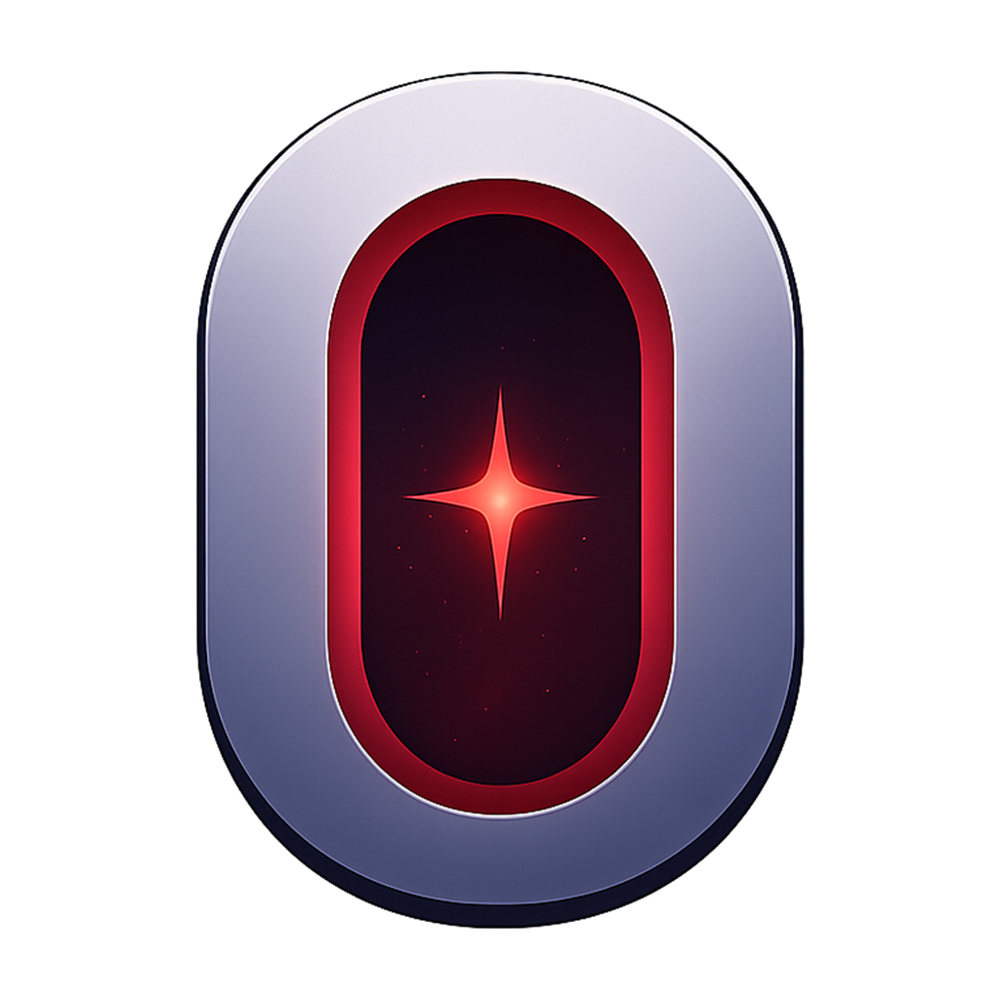

<p align="center">
  
</p>

# Orion: A Multiverse of Stories

Discover, watch, and organize movies, series, and anime across Orion Mobile and Desktop. Orion Connect links the two on your local network, while Music Planet brings music discovery and listening to Desktop.

[Official releases](https://github.com/OK-ALI/Orion/releases) · [Mobile 4.0 release notes](docs/releases/mobile-v4.0.0.md) · [Music Planet architecture](docs/architecture/music.md)

## Platforms and releases

| Part of Orion | Current public status | Role |
| --- | --- | --- |
| **Orion Mobile** | [v4.0.0 for Android](https://github.com/OK-ALI/Orion/releases/tag/v4.0.0), released October 14, 2026 | Cinema, Glimpse, Library, downloads, and account features on Android |
| **Orion Desktop** | [v3.2.0 for Windows](https://github.com/OK-ALI/Orion/releases/tag/v3.2.0) | Cinema and Music Planet; Desktop 4.0 has not been publicly released |
| **Orion Connect** | Included integration | Pair Desktop and Mobile on the same Wi-Fi / LAN |
| **Music Planet** | Desktop feature | Music discovery, playback, lyrics, playlists, and Local Library |
| **Orion TV** | Planned | Future TV integration; no public TV application is offered here |

Mobile v4.1.0 is a development target, not a published release. Package versions in the monorepo can differ by platform and do not establish public release status.

## Orion Mobile

- **Cinema:** Browse and search movies, TV, and anime; open title details and choose streaming sources. Playback continuity includes Resume, Start from Beginning, Replay Last 30, and Next Episode where supported.
- **Library:** Keep My List, viewing history, watched state, playback progress, and Continue Watching, with filtering and sorting.
- **Downloads:** Manage downloads and play supported downloaded media offline, including available subtitle tracks.
- **Glimpse:** Discover titles through a vertical clip feed, search and filter clips, and keep private Likes on the device. Start muted, Auto-advance, Ambient glow, and Remember my place are configurable.
- **Feedback Center:** Send a problem report, feature suggestion, or general feedback with optional diagnostics, screenshot, and reply address. Successful submissions receive an Orion Feedback ID and local history.
- **Account and Orion Cloud:** Google sign-in and account-scoped synchronization for supported Library information, with explicit synchronization controls.
- **Personalization:** Six themes—Midnight Premiere, AMOLED, Mocha, Slate, Projector Silver, and Custom—plus custom accent, Home Layout, Performance Profiles, and Reduced Motion.
- **Release information:** A one-time upgrade Welcome and offline native Release Notes complement the existing update flow.

Source capabilities vary. Embedded controls, incoming resume, subtitles, audio choices, and downloads depend on the selected provider. AniLink remains a manual Anime source with documented playback and resume limitations. Glimpse clips also depend on uploader availability, regional permissions, and embed support.

The published Android baseline requires **Android 7.0 / API 24 or newer**. Install official updates in place to retain app data; do not uninstall Orion first.

## Desktop, Music Planet, and Connect

Desktop combines Cinema with Music Planet. Music Planet includes YouTube Music catalog discovery, YouTube Audio playback, lyrics, Local Library, playlists, favorites, queue, and radio. Its provider and playback boundaries are described in the [architecture record](docs/architecture/music.md).

Orion Connect pairs Desktop and Mobile over the local network. Its discovery, pairing, and remote-media capabilities are implemented in the platform applications and shared protocol contracts. Both applications must be reachable on the same Wi-Fi / LAN.

Desktop development and public release qualification proceed separately from Mobile.

## Repository layout

```text
apps/
  mobile/       React Native, Expo, TypeScript, Android plugins and local modules
  desktop/      Electron and React application, Cinema and Music Planet
packages/
  shared/       Shared types, API clients, design tokens, source registry and protocols
docs/           Architecture, release notes, handoffs and qualification records
scripts/        Repository release maps, manifests and qualification utilities
```

The root package coordinates npm workspaces. Mobile application identity lives in `apps/mobile/package.json` and `apps/mobile/app.json`; the root and Desktop version numbers are independent.

## Development

Use the committed `package-lock.json` and **Node.js 22.13+ in the 22.x line or 24.3+ in the 24.x line**, with a compatible npm version. The locked Mobile stack includes **Expo 57**, **React Native 0.86.3**, **React 19.2.3**, and **TypeScript**. Dependency manifests and the lockfile are the compatibility authority.

```powershell
git clone https://github.com/OK-ALI/Orion.git
cd Orion
npm ci
```

To inspect the published Mobile baseline, check out tag `v4.0.0` before installing dependencies. In PowerShell, use `npm.cmd` if execution policy blocks `npm.ps1`.

### Mobile

```powershell
npm run start --workspace @orion/mobile
npm run web --workspace @orion/mobile
```

Android integrations use Orion's native plugins and modules. Expo Go and the web preview do not qualify native playback, downloads, Google sign-in, Connect, or the updater.

For native Android work, install a compatible JDK and the Android SDK, then set `JAVA_HOME` and `ANDROID_HOME`. The generated Android project and locked native dependencies determine the required SDK, build tools, NDK, CMake, and Gradle wrapper versions.

```powershell
cd apps/mobile
npx expo prebuild --platform android --no-install
cd ../..
npm run build:android:standalone --workspace @orion/mobile
```

The standalone pipeline requires valid local Mobile runtime configuration, including `EXPO_PUBLIC_ORION_GOOGLE_WEB_CLIENT_ID` and `EXPO_PUBLIC_TMDB_READ_TOKEN`. Keep configuration values out of source control. Standalone debug builds use a debug signing certificate and the same package identifier as production: use a clean emulator or a dedicated test device, without replacing or removing an existing production installation.

Official release builds use `npm run build:android:release --workspace @orion/mobile` and require the original Orion signing credentials. Never substitute a new production key. Generated native directories are build output; authoritative native integrations live in the checked-in plugins and modules.

### Desktop

After the complete workspace install:

```powershell
npm run start --workspace @orion/desktop
```

This builds the renderer and starts Electron. See the Desktop workspace scripts for platform packaging; packaging and publishing are separate operations.

### Validation

```powershell
npm run typecheck --workspace @orion/shared
npm run typecheck --workspace @orion/mobile
npm test --workspace @orion/mobile
npm run check:source-size --workspace @orion/mobile
npm run check:expo --workspace @orion/mobile
npm run build:web --workspace @orion/mobile
```

Some Mobile preservation checks expect the generated Android project and the reviewed release Gradle configuration. A plain Expo prebuild alone does not reproduce every release prerequisite. The v4.0.0 [release audit](docs/mobile-v4-release-audit.md) records five inherited Download source-assertion failures; results must be compared with that baseline rather than treated as a universally green suite.

Desktop has its own `npm run check --workspace @orion/desktop` and `npm run test:electron --workspace @orion/desktop` gates. Android compilation, native tests, real playback, physical-device checks, and updater qualification remain separate from JavaScript or web checks.

## Security and release integrity

- Obtain APKs and Desktop installers from [official GitHub Releases](https://github.com/OK-ALI/Orion/releases).
- Android updates preserve `com.okali.orion` and the original signing authority. The updater verifies release identity, integrity, and signer before installation.
- Never commit private environment files, OAuth tokens, provider credentials, signing material, user data, logs, caches, managed tools, or generated build artifacts.
- Desktop protects sensitive provider data and local paths behind its main-process boundary. Mobile uses its existing secure account and native authorization paths; exported or synchronized data must respect those boundaries.
- Third-party media availability is outside Orion's control. DRM circumvention is not supported. Access and download only media you are authorized to use.

## License and attribution

The root, Desktop, and shared package manifests declare **GPL-3.0**. Third-party components and retained template notices keep their own license terms; for example, `apps/mobile/LICENSE` contains the Expo template's MIT notice. Preserve applicable license and attribution notices when redistributing components.

Historical release documents remain available under [`docs/releases/`](docs/releases/).
